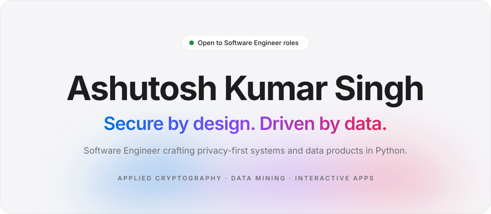
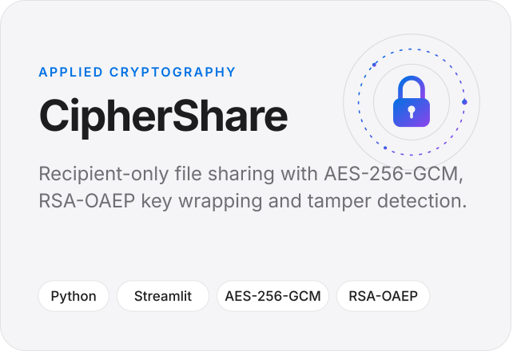
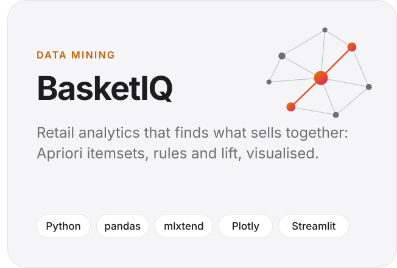
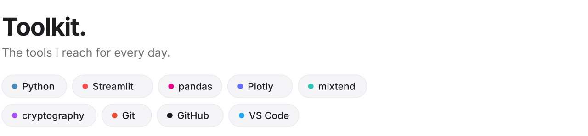

<!-- Designed as a set of light/dark SVGs in ./assets; the visible page follows the viewer's GitHub theme. -->

<picture><source media="(prefers-color-scheme: dark)" srcset="assets/hero-dark.svg"></picture>

  

<picture><source media="(prefers-color-scheme: dark)" srcset="assets/work-dark.svg"></picture>

<a href="https://github.com/Ashutosh3412/ciphershare-secure-file-sharing"><picture><source media="(prefers-color-scheme: dark)" srcset="assets/card-ciphershare-dark.svg"></picture></a><a href="https://github.com/Ashutosh3412/basketiq-market-basket-analysis"><picture><source media="(prefers-color-scheme: dark)" srcset="assets/card-basketiq-dark.svg"></picture></a>

 

<picture><source media="(prefers-color-scheme: dark)" srcset="assets/toolkit-dark.svg"></picture>
